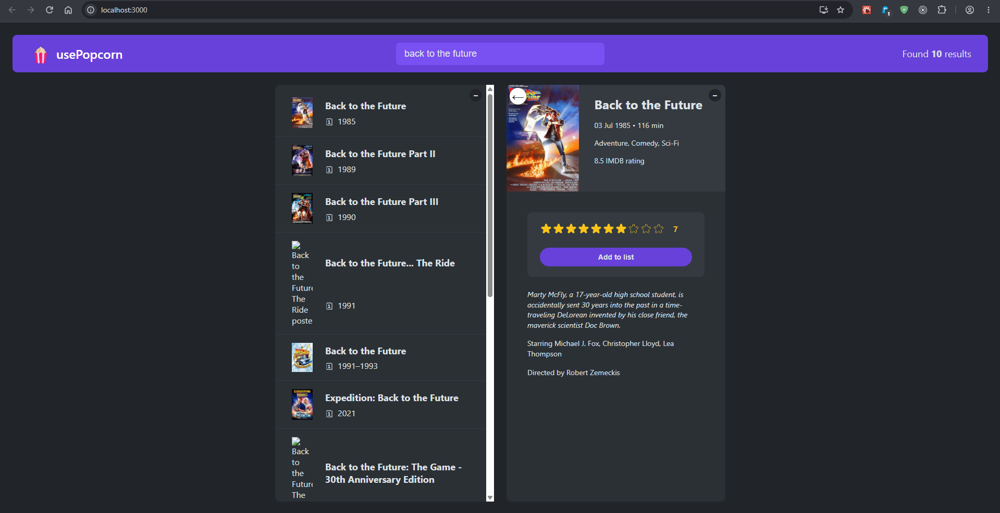

# usePopcorn 🍿

A small React app for searching movies and keeping track of the ones you've watched.

> This project was built while following **"The Ultimate React Course"** by Jonas Schmedtmann on Udemy. It is not an original idea and was not built from scratch: I started from the [starter files provided in the course](https://github.com/jonasschmedtmann/ultimate-react-course/tree/5c38ad0e9f5067d4a486e8ee5d7bed36268fbbb8/07-usepopcorn/starter) and implemented the app logic step by step to practice React.

## Features

- Search movies by title using the OMDb API
- View movie details: poster, plot, cast, director, IMDb rating
- Rate movies with a custom star rating component
- Keep a list of watched movies, saved in local storage
- See a summary of your watched movies (average ratings, runtime)
- Keyboard shortcuts: Enter focuses the search bar, Escape closes the movie details

## What I practiced

- `useState`, `useEffect`, `useRef`
- Fetching data with cleanup (`AbortController`)
- Custom hooks (`useMovies`, `useLocalStorage`, `useKey`)
- Component composition and reusable components

## Tech

React, OMDb API, CSS

## Screenshots

## Demo

